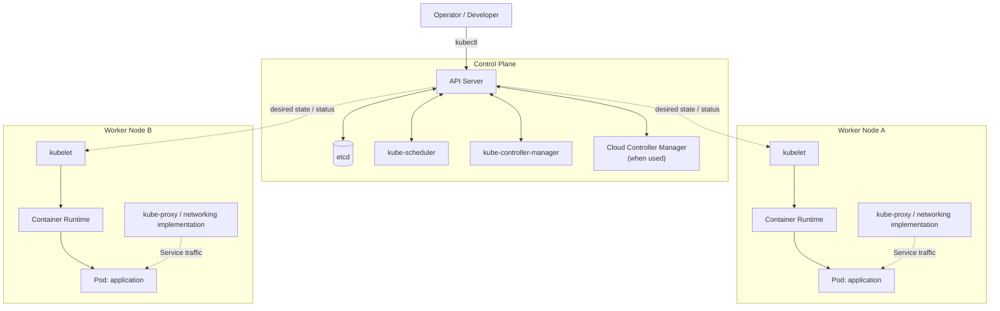
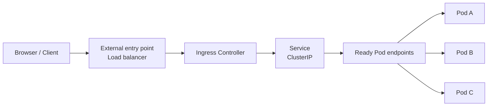
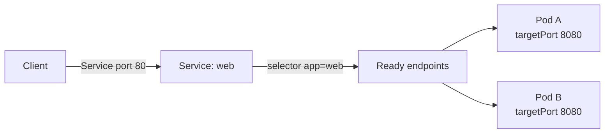
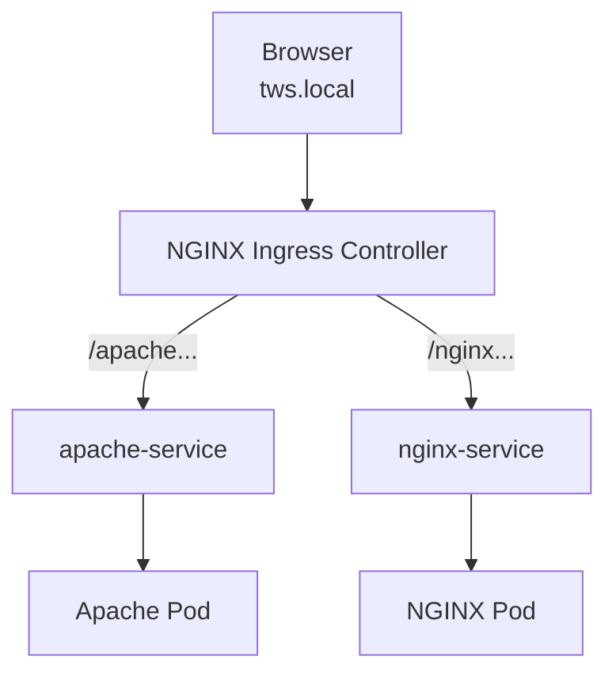
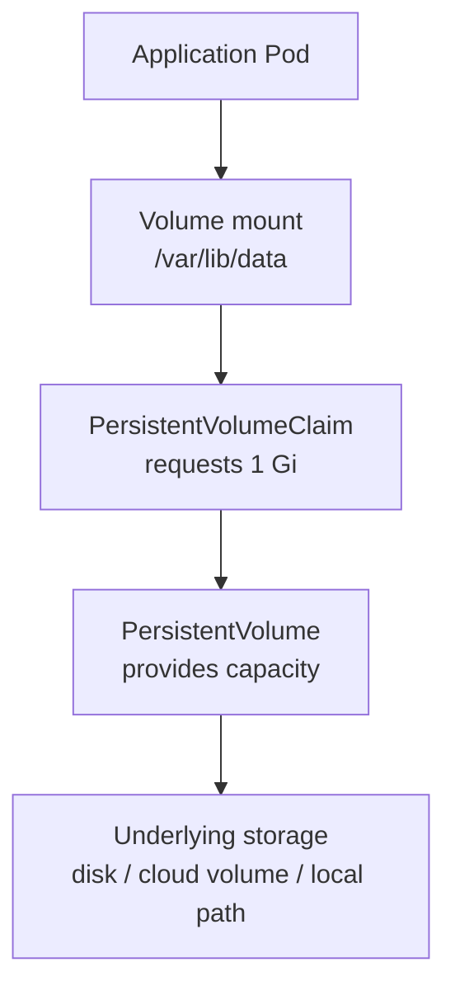
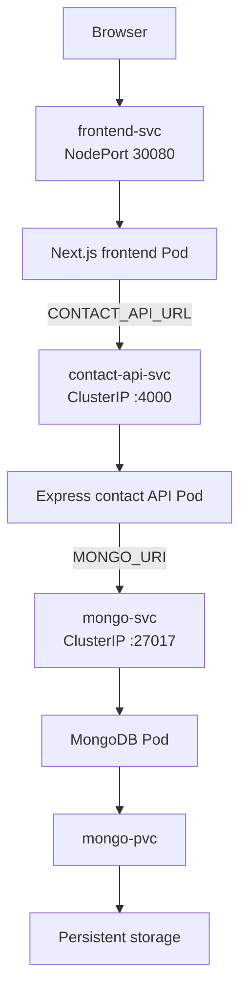

# 📘 Kubernetes — Beginner's Notes & Practical Guide

> A step-by-step companion to the manifests in this repository. Start with the concepts, then connect each idea to the YAML file and the `kubectl` commands.

**Repository:** [amitweb2012/kubernetes-cheatsheet](https://github.com/amitweb2012/kubernetes-cheatsheet)  
**Main overview:** [../README.md](../README.md)

---

## Table of contents

1. [What is Kubernetes?](#1-what-is-kubernetes)
2. [Core architecture](#2-core-architecture)
3. [Important Kubernetes objects](#3-important-kubernetes-objects)
4. [How a request reaches a Pod](#4-how-a-request-reaches-a-pod)
5. [Understand a YAML manifest](#5-understand-a-yaml-manifest)
6. [Local learning environment](#6-local-learning-environment)
7. [Namespaces](#7-namespaces)
8. [Pods](#8-pods)
9. [Deployments and ReplicaSets](#9-deployments-and-replicasets)
10. [Services and networking](#10-services-and-networking)
11. [Service discovery and DNS](#11-service-discovery-and-dns)
12. [Ingress](#12-ingress)
13. [Persistent storage](#13-persistent-storage)
14. [Jobs and CronJobs](#14-jobs-and-cronjobs)
15. [DaemonSets](#15-daemonsets)
16. [StatefulSets and ConfigMaps](#16-statefulsets-and-configmaps)
17. [RBAC and the Dashboard example](#17-rbac-and-the-dashboard-example)
18. [Next.js microservices project](#18-nextjs-microservices-project)
19. [Useful kubectl commands](#19-useful-kubectl-commands)
20. [Troubleshooting guide](#20-troubleshooting-guide)
21. [Important improvements to validate in this repository](#21-important-improvements-to-validate-in-this-repository)
22. [Suggested practice plan](#22-suggested-practice-plan)
23. [Glossary](#23-glossary)

---

## 1. What is Kubernetes?

Kubernetes (often shortened to **K8s**) is an open-source platform for deploying, scaling, and managing containerized applications.

Imagine that you have a web application running in a container. In a real environment you may need multiple copies of that application, traffic distribution, health checks, scaling, configuration, and persistent storage. Kubernetes helps coordinate these tasks across a group of machines.

### Why do we need it?

Without an orchestrator, an operator may have to manually:

- Start application containers on machines.
- Restart failed containers.
- Decide where new application instances should run.
- Keep the number of application instances at the required level.
- Connect applications to each other.
- Roll out a new version without taking the whole application offline.

Kubernetes lets you declare the desired state. Its control loops work continuously to move the cluster toward that state.

### A simple example

You declare that an application should have three replicas:

```yaml
spec:
  replicas: 3
```

Kubernetes attempts to keep three matching Pods running. If one Pod disappears, its managing controller creates a replacement. You describe the goal; Kubernetes manages the ongoing work.

---

## 2. Core architecture

A Kubernetes cluster consists of a **control plane** and one or more **worker nodes**.



### Control plane components

| Component | Beginner-friendly explanation |
|---|---|
| **API Server** | The front door to the Kubernetes API. `kubectl`, controllers, and other clients communicate with the cluster through it. |
| **etcd** | Consistent key-value store holding Kubernetes API data and cluster state. Protect and back it up carefully. |
| **kube-scheduler** | Selects a suitable worker node for Pods that do not yet have one. It considers resources, constraints, and scheduling rules. |
| **kube-controller-manager** | Runs control loops that compare desired state with actual state and make corrective changes. |
| **Cloud Controller Manager** | Integrates with supported cloud-provider functionality, such as cloud load balancers and node information. It is not present in every cluster. |

### Worker node components

| Component | Beginner-friendly explanation |
|---|---|
| **kubelet** | Agent on a node. It watches for Pods assigned to that node and works to keep their containers healthy. |
| **Container runtime** | Pulls images and runs containers. Common Kubernetes CRI runtimes include containerd and CRI-O. |
| **kube-proxy** | In clusters that use it, helps implement Service networking rules. Some clusters use an alternative networking implementation. |
| **Pod** | The workload unit Kubernetes schedules. One Pod may contain one or more closely related containers. |

### Control-plane request flow

1. You run `kubectl apply -f deployment.yaml`.
2. The API Server authenticates and authorizes the request, validates it, and stores the accepted object state.
3. The Deployment controller notices that a Deployment is desired.
4. It creates or updates a ReplicaSet; the ReplicaSet controller makes sure the desired number of Pods exists.
5. The scheduler selects nodes for unscheduled Pods.
6. The kubelet on each selected node asks its container runtime to start the required containers.
7. The kubelet reports status back through the API Server.

**Important distinction:** the API Server is the API entry point; etcd is the backing store. The scheduler chooses nodes; the kubelet runs the assigned workload on a node.

---

## 3. Important Kubernetes objects

| Object | What it does | Typical use |
|---|---|---|
| Namespace | Groups namespaced resources | Separate dev, test, and production resources |
| Pod | Runs one or more containers | Run an application instance |
| ReplicaSet | Keeps a target number of Pod replicas | Usually managed by a Deployment |
| Deployment | Manages stateless application rollouts and replica sets | Web/API applications |
| Service | Stable network endpoint for selected Pods | Internal or external service access |
| Ingress | HTTP/HTTPS routing rules | Route hostnames or URL paths |
| ConfigMap | Stores non-confidential configuration | Feature flags, config files |
| Secret | Stores sensitive configuration data | Passwords, tokens, certificates |
| PersistentVolume (PV) | Represents provisioned storage | Durable storage resource |
| PersistentVolumeClaim (PVC) | Requests storage | Application's storage claim |
| Job | Runs a task to completion | Data import, one-time task |
| CronJob | Creates Jobs on a schedule | Periodic reports or backups |
| DaemonSet | Runs a Pod on each eligible node | Log agents, node monitoring |
| StatefulSet | Manages Pods with stable identity and storage association | Databases and stateful systems |

---

## 4. How a request reaches a Pod

A common web application path looks like this:



- **External entry point:** how traffic enters the cluster. This might be a cloud load balancer, a local port mapping, or another network component.
- **Ingress Controller:** watches Ingress resources and configures HTTP routing. An Ingress resource alone does not provide a controller.
- **Service:** provides a stable virtual endpoint and selects Pods using labels.
- **Pod endpoints:** the set of eligible backend Pod IPs for a Service.
- **Pod:** runs the application container.

Not every Kubernetes application uses Ingress. Internal traffic often goes directly from one Service to another. A Service can also be exposed with NodePort or LoadBalancer when appropriate.

---

## 5. Understand a YAML manifest

Kubernetes manifests are declarative YAML documents. A typical resource has four important top-level fields:

```yaml
apiVersion: v1
kind: Pod
metadata:
  name: example-pod
  labels:
    app: example
spec:
  containers:
    - name: app
      image: nginx:1.27
      ports:
        - containerPort: 80
```

| Field | Meaning |
|---|---|
| `apiVersion` | API group and version for the resource |
| `kind` | Type of Kubernetes object |
| `metadata` | Name, namespace, labels, annotations |
| `spec` | Desired configuration |
| `status` | Current observed state, normally populated by Kubernetes |

### Labels and selectors

Labels are key-value metadata attached to objects:

```yaml
labels:
  app: nginx
```

A selector finds objects with matching labels:

```yaml
selector:
  matchLabels:
    app: nginx
```

The label on the Pod template must match the Deployment selector. A Service's selector must match the labels on the Pods it should route to. A mismatch can leave a Service with no endpoints.

### Resource requests and limits

- **Request:** amount used for scheduling decisions and resource reservation.
- **Limit:** maximum resource amount the container is allowed to consume, subject to the resource type and runtime behavior.

```yaml
resources:
  requests:
    cpu: 250m
    memory: 64Mi
  limits:
    cpu: 500m
    memory: 128Mi
```

`250m` means one quarter of a CPU core. `Mi` is a mebibyte unit. Put `resources` inside the relevant container object under `spec.containers`.

---

## 6. Local learning environment

This repository includes a KinD cluster configuration and examples that can also be adapted for Minikube.

### Option A: KinD

KinD runs Kubernetes nodes as Docker containers. The repository's `kind-config.yaml` defines one control-plane and three worker nodes, using `kindest/node:v1.33.1`, and maps host ports 80 and 443 on one worker.

Create the cluster:

```bash
kind create cluster --name learning-cluster --config kind-config.yaml
kubectl cluster-info
kubectl get nodes -o wide
```

Use the cluster name consistently when deleting it:

```bash
kind delete cluster --name learning-cluster
```

### Option B: Minikube

```bash
minikube start --driver=docker
kubectl get nodes
```

For NodePort Services, Minikube can provide a URL:

```bash
minikube service <service-name> -n <namespace> --url
```

### Useful first checks

```bash
kubectl version --client
kubectl config current-context
kubectl get nodes
kubectl get namespaces
```

---

## 7. Namespaces

A Namespace is a logical grouping for namespaced Kubernetes objects. It helps organize resources and separate environments or teams.

This repository's [namespace.yaml](../namespace.yaml) creates:

```yaml
apiVersion: v1
kind: Namespace
metadata:
  name: nginx-test
```

Create and inspect it:

```bash
kubectl apply -f namespace.yaml
kubectl get namespaces
kubectl get all -n nginx-test
```

When a manifest sets `metadata.namespace: nginx-test`, apply it after the namespace exists.

**Remember:** a namespace is not a separate cluster and is not, by itself, a security boundary. Use RBAC, NetworkPolicies, quotas, and admission controls where isolation is required.

---

## 8. Pods

A Pod is the smallest deployable unit Kubernetes schedules. A Pod contains one or more containers that share the Pod network namespace and can share mounted volumes.

### Repository example: [pod.yaml](../pod.yaml)

This manifest creates a Pod named `nginx-pod` in `nginx-test`:

- Runs the `nginx:latest` image.
- Declares container port 80.
- Requests 250 millicores of CPU and 64 MiB memory.
- Sets limits of 500 millicores and 128 MiB memory.
- Uses `restartPolicy: Always`.

Apply and inspect:

```bash
kubectl apply -f namespace.yaml
kubectl apply -f pod.yaml
kubectl get pod nginx-pod -n nginx-test
kubectl describe pod nginx-pod -n nginx-test
kubectl logs nginx-pod -n nginx-test
kubectl exec -it nginx-pod -n nginx-test -- sh
```

### Pod versus container

| Container | Pod |
|---|---|
| Runtime instance of an image | Kubernetes scheduling and deployment unit |
| Has its own process/filesystem isolation | Has a shared network namespace for its containers |
| Runs inside a Pod in Kubernetes | Can contain one or more containers |
| Container port is declared by the container | Pod IP is shared by containers in that Pod |

Containers in the same Pod can communicate over `localhost`. Containers in different Pods normally communicate over the cluster network, often through Services.

### Why not deploy production applications as standalone Pods?

A standalone Pod is not automatically recreated by a Deployment or ReplicaSet if it is deleted. For most long-running stateless applications, create a Deployment and let it manage Pods.

### Second example: [pod-nodeport.yml](../pod-nodeport.yml)

This file contains two Pod documents separated by `---`. Both are placed in the `nginx-test` namespace. They run Fleetman web application image versions and use labels such as `app: fleetman` and `release`.

The labels matter because a matching Service can select Pods by them. The filename says NodePort, but **a Pod by itself does not create a NodePort**; a Service resource is needed to expose it through a NodePort.

---

## 9. Deployments and ReplicaSets

A Deployment manages a stateless application's ReplicaSets and Pods. It supports scaling, declarative updates, and rollout history.

### Repository example: [deployment.yaml](../deployment.yaml)

The example intends to create three NGINX replicas:

```yaml
spec:
  replicas: 3
  selector:
    matchLabels:
      app: nginx
  template:
    metadata:
      labels:
        app: nginx
```

The selector and Pod-template labels match on `app: nginx`. The Pod template also mounts a PVC named `local-pvc` at `/var/www/html`.

Apply and inspect:

```bash
kubectl apply -f namespace.yaml
kubectl apply -f persistent-volumn.yaml
kubectl apply -f persistent-volumn-claim.yaml
kubectl apply -f deployment.yaml

kubectl get deployments -n nginx-test
kubectl get replicasets -n nginx-test
kubectl get pods -n nginx-test -o wide
```

The storage resources are needed because the Deployment references the `local-pvc` claim. Confirm that the claim is `Bound` before expecting the Pods to become ready.

### Scaling

```bash
kubectl scale deployment nginx-deployment --replicas=5 -n nginx-test
kubectl get pods -n nginx-test
```

### Rolling update example

The [deployment-nodeport.yaml](../deployment-nodeport.yaml) file defines a three-replica Fleetman Deployment. Its comments show an image update:

```bash
kubectl set image deployment/fleetman-deployment \
  fleetman-container=richardchesterwood/k8s-fleetman-webapp-angular:release0-5 \
  -n nginx-test

kubectl rollout status deployment/fleetman-deployment -n nginx-test
kubectl rollout history deployment/fleetman-deployment -n nginx-test
kubectl rollout undo deployment/fleetman-deployment -n nginx-test
```

A rolling update replaces old Pods progressively according to the Deployment strategy. Check the rollout status rather than assuming that an accepted command means the application is healthy.

---

## 10. Services and networking

Pods are replaceable. Their IP addresses can change when they are recreated. A Service provides a stable endpoint in front of a changing set of Pods.

A Service uses a selector to find the Pods that should receive traffic.

### Service types

| Type | Reachability | Typical purpose |
|---|---|---|
| **ClusterIP** | Inside the cluster | Default internal service-to-service communication |
| **NodePort** | Through a port on each node | Simple external access, often for learning or specific network designs |
| **LoadBalancer** | Through an external load balancer when supported | External application access in cloud or integrated environments |
| **ExternalName** | DNS alias to an external hostname | Refer to an external DNS name through a Service name |

### ClusterIP: [service.yaml](../service.yaml)

The NGINX Service selects Pods labelled `app: nginx`, exposes Service port 80, and forwards to target port 80.

```yaml
spec:
  selector:
    app: nginx
  ports:
    - protocol: TCP
      port: 80
      targetPort: 80
  type: ClusterIP
```

- `port`: port exposed by the Service.
- `targetPort`: destination port on a selected Pod.
- `selector`: label query used to find backend Pods.

Find it:

```bash
kubectl get services -n nginx-test
kubectl describe service nginx-service -n nginx-test
kubectl get endpointslices -n nginx-test
```

### NodePort: [service-nodeport.yaml](../service-nodeport.yaml)

The Fleetman Service declares NodePort 30080. The intended access pattern is:

```text
http://<NODE-IP>:30080
```

A NodePort is allocated from the cluster's configured NodePort range (commonly 30000–32767). It forwards traffic to the Service's selected Pod endpoints. Ensure the selector matches the intended Pods and the target port is correct.

### Port terminology

Suppose the application listens on port 8080 inside its container:

- `containerPort: 8080` documents the port used by the container.
- Service `targetPort: 8080` directs traffic to that container port.
- Service `port: 80` is the port clients use on the Service.
- NodePort `nodePort: 30080` is the port clients use on a node.

### Service selection flow



---

## 11. Service discovery and DNS

Kubernetes provides DNS records for Services so applications can discover other applications by name rather than hard-coding Pod IP addresses.

A typical Service DNS name is:

```text
<service-name>.<namespace>.svc.cluster.local
```

For example, a Service called `database` in the `default` namespace may be reached with:

```text
database.default.svc.cluster.local
```

From a Pod in the same namespace, the shorter name `database` is usually enough. From another namespace, use the namespace-qualified name.

### Repository examples

- [service-discovery/pods.yaml](../service-discovery/pods.yaml) defines a webapp Deployment and a queue Pod.
- [service-discovery/services.yaml](../service-discovery/services.yaml) defines NodePort Services for the webapp and queue.
- [service-discovery/networking-tests.yaml](../service-discovery/networking-tests.yaml) creates a MySQL Pod and a ClusterIP Service called `database`.
- [service-discovery/readme.md](../service-discovery/readme.md) contains a short DNS lookup walkthrough.

### Try DNS lookup

First apply the database Pod and Service:

```bash
kubectl apply -f service-discovery/networking-tests.yaml
kubectl get pods
kubectl get services
```

Start a temporary debug Pod with DNS utilities (the image must contain the tools you use):

```bash
kubectl run dns-test --image=busybox:1.36 --restart=Never -- sleep 3600
kubectl exec -it dns-test -- nslookup database
kubectl delete pod dns-test
```

For a Pod inside the same namespace, `database` resolves to the Service's ClusterIP. The fully qualified name is `database.default.svc.cluster.local` when the Service is in `default`.

**Note:** the provided `networking-tests.yaml` has no explicit namespace, so its resources are created in the current namespace (normally `default`) unless your kubectl context sets another default namespace.

---

## 12. Ingress

Ingress is an API object that describes HTTP/HTTPS routing rules from outside the cluster to Services. You also need an Ingress Controller—such as an NGINX Ingress Controller—to watch and implement those rules.

### Repository folder: [ingress/](../ingress/)

| File | Purpose |
|---|---|
| `namespace.yaml` | Creates `ingress-test` |
| `apache.yaml` | Apache Deployment and ClusterIP Service |
| `nginx.yaml` | NGINX Deployment and ClusterIP Service |
| `ingress.yaml` | Routes host `tws.local` paths to Services |
| `readme.md` | Basic apply commands |

### Traffic routing in this example

The Ingress manifest defines host `tws.local` and routes paths to Apache and NGINX Services. It uses the class name `nginx` and NGINX-specific annotations.



Apply the resources:

```bash
kubectl apply -f ingress/namespace.yaml
kubectl apply -f ingress/apache.yaml
kubectl apply -f ingress/nginx.yaml
kubectl apply -f ingress/ingress.yaml
kubectl get ingress -n ingress-test
```

Before applying, install an Ingress Controller compatible with your local cluster and confirm an IngressClass named `nginx` exists:

```bash
kubectl get ingressclass
kubectl get pods -A
```

The repository's Ingress manifest uses regex and rewrite annotations. Those annotations are specific to the NGINX Ingress Controller; they are not portable to every controller. Review the path types and rewrite behavior for your controller version.

The comment in `ingress/readme.md` uses relative paths such as `namespace.yaml`; when running commands from the repository root, prefix them with `ingress/` as shown above.

---

## 13. Persistent storage

Container filesystems are not a safe place for data that must survive Pod replacement. Kubernetes storage objects separate the application's storage request from the underlying storage resource.

### PV, PVC and Pod relationship



### PersistentVolume (PV)

A PV represents storage made available to the cluster. In [persistent-volumn.yaml](../persistent-volumn.yaml), the example declares:

- Name: `local-pv`.
- Capacity: `1Gi`.
- Access mode: `ReadWriteOnce`.
- Reclaim policy: `Retain`.
- Storage class: `local-storage`.
- Backing path: `/mnt/data` using `hostPath`.

### PersistentVolumeClaim (PVC)

A PVC is an application or user's request for storage. In [persistent-volumn-claim.yaml](../persistent-volumn-claim.yaml), the claim requests 1 Gi and specifies the `local-storage` class and `local-pv` volume.

Apply and inspect:

```bash
kubectl apply -f namespace.yaml
kubectl apply -f persistent-volumn.yaml
kubectl apply -f persistent-volumn-claim.yaml
kubectl get pv
kubectl get pvc -n nginx-test
```

The PV/PVC example is educational and uses `hostPath`. A PV is cluster-scoped, so its `metadata.namespace` field does not make it namespaced. Also, a local host path belongs to one node and is not equivalent to resilient shared storage. For real clusters, prefer an appropriate CSI storage driver and StorageClass.

### Access modes in brief

- `ReadWriteOnce`: read-write mounting by one node at a time; it does not simply mean one Pod.
- `ReadOnlyMany`: read-only mounting by many nodes when the storage driver supports it.
- `ReadWriteMany`: read-write mounting by many nodes when the storage driver supports it.
- `ReadWriteOncePod`: read-write mounting by a single Pod when supported.

The actual behavior depends on the volume type and CSI driver.

---

## 14. Jobs and CronJobs

### Job

A Job creates Pods to complete a task. Unlike a web server, a batch task is expected to finish.

Repository file: [job.yaml](../job.yaml)

It runs a BusyBox command that prints a message and sleeps for 30 seconds. It requests one completion with parallelism of one.

```bash
kubectl apply -f job.yaml
kubectl get jobs -n nginx-test
kubectl get pods -n nginx-test
kubectl logs job/nginx-job -n nginx-test
```

Once complete, the Job remains as an API object until cleaned up or garbage-collected according to its configuration. Delete it after practice:

```bash
kubectl delete job nginx-job -n nginx-test
```

### CronJob

A CronJob creates Jobs on a time schedule. Repository file: [cron-job.yaml](../cron-job.yaml).

The schedule `* * * * *` means once every minute. The sample command copies data between two directories mounted from `hostPath` volumes.

```bash
kubectl apply -f cron-job.yaml
kubectl get cronjobs -n nginx-test
kubectl get jobs -n nginx-test
kubectl get pods -n nginx-test
```

Cron schedule format:

```text
* * * * *
│ │ │ │ └── Day of week (0–7, depending on implementation)
│ │ │ └──── Month
│ │ └────── Day of month
│ └──────── Hour
└────────── Minute
```

The example's `hostPath` directories are node-local. For real backups, use storage designed for the workload, secure credentials, retention policies, and preferably an object-storage or backup system. A CronJob schedule does not by itself guarantee exactly-once execution; design tasks to be safe to repeat.

Stop the every-minute demonstration when finished:

```bash
kubectl delete cronjob nginx-cronjob -n nginx-test
```

---

## 15. DaemonSets

A DaemonSet ensures that a copy of a Pod runs on each eligible node. It is commonly used for node-level services such as log collectors, monitoring agents, and some networking components.

Repository file: [daemonSets.yaml](../daemonSets.yaml)

The example requests an NGINX Pod on each eligible node, with CPU and memory requests and limits.

```bash
kubectl apply -f daemonSets.yaml
kubectl get daemonsets -n nginx-test
kubectl get pods -n nginx-test -o wide
```

### Deployment versus DaemonSet

| Deployment | DaemonSet |
|---|---|
| Maintains a requested replica count | Maintains a Pod on each eligible node |
| Scheduler can place replicas on suitable nodes | DaemonSet controller targets eligible nodes |
| Suitable for web/API replicas | Suitable for node-level agents |

A DaemonSet does not always run on every node: node selectors, affinity, taints, tolerations, and other scheduling constraints can affect eligibility.

---

## 16. StatefulSets and ConfigMaps

A StatefulSet manages applications that need stable Pod identities and persistent storage associations. It is commonly used for databases and distributed systems that need predictable identity.

Repository file: [statefulset-configmap.yaml](../statefulset-configmap.yaml)

This multi-document YAML file defines:

1. Namespace `mysql-test`.
2. ConfigMap `mysql-config`.
3. Headless Service `mysql`.
4. PVC `mysql-pvc`.
5. StatefulSet `mysql`.

### What is a ConfigMap?

A ConfigMap stores non-confidential configuration as key-value entries. This sample provides MySQL environment values. **Passwords are confidential and should not be stored in a ConfigMap.** Use a Kubernetes Secret or an external secret manager for passwords in a secure setup.

### What is a headless Service?

The Service sets `clusterIP: None`. It does not allocate a normal virtual ClusterIP. For StatefulSet workloads, it can provide stable DNS identity for Pods.

### What is a StatefulSet?

The StatefulSet creates a MySQL Pod with an ordered identity and a persistent volume association. This sample uses a PVC named `mysql-pvc`, mounts it at `/var/lib/mysql`, and defines liveness and readiness probes.

Apply and inspect:

```bash
kubectl apply -f statefulset-configmap.yaml
kubectl get statefulsets -n mysql-test
kubectl get pods -n mysql-test
kubectl get services -n mysql-test
kubectl get pvc -n mysql-test
kubectl describe pod mysql-0 -n mysql-test
```

Port-forward to the database for local testing:

```bash
kubectl port-forward -n mysql-test statefulset/mysql 3306:3306
```

Then connect with a compatible MySQL client on your computer.

**Before running:** the file requests a StorageClass named `standard`. Check whether your cluster provides it:

```bash
kubectl get storageclass
```

The sample also places database credentials in a ConfigMap, and its PVC does not define a `volumeName` or explicit storage class provisioning strategy. Adapt it to your cluster and move credentials to a Secret before treating it as a secure deployment.

### StatefulSet versus Deployment

- Choose a Deployment for interchangeable stateless replicas.
- Choose a StatefulSet when stable Pod identity, ordered rollout/scaling, and per-replica storage associations matter.
- A StatefulSet alone does not make a database highly available. Database replication, backups, failover, and recovery need their own design.

---

## 17. RBAC and the Dashboard example

Kubernetes RBAC (Role-Based Access Control) determines which identities can perform which actions on Kubernetes resources.

The [dashboard-admin-user.yml](../dashboard-admin-user.yml) manifest creates:

- A ServiceAccount called `admin-user` in the `kubernetes-dashboard` namespace.
- A ClusterRoleBinding that binds that account to the built-in `cluster-admin` ClusterRole.

**Security warning:** `cluster-admin` grants extremely broad privileges across the cluster. This sample is only for understanding the RBAC object relationship. Do not use this binding as a default or leave it in place for routine access.

### Safer RBAC principles

- Grant the smallest set of permissions needed.
- Prefer a namespaced Role and RoleBinding if access is only needed in one namespace.
- Avoid long-lived, manually managed bearer tokens.
- Keep credentials out of Git.
- Review Kubernetes Dashboard's current authentication guidance before enabling access.

Useful inspection commands:

```bash
kubectl get serviceaccounts -A
kubectl get clusterrolebindings
kubectl describe clusterrolebinding admin-user
kubectl auth can-i list pods --as=system:serviceaccount:kubernetes-dashboard:admin-user
```

---

## 18. Next.js microservices project

The [next15-micro-k8s/](../next15-micro-k8s/) folder is a larger hands-on application example. Its own [README](../next15-micro-k8s/README.md) explains application setup. This section connects its parts to Kubernetes concepts.

### Application architecture



### Kubernetes manifests

| File | Purpose |
|---|---|
| `k8s/namespace.yaml` | Creates `nginx-test` |
| `k8s/mongo.yaml` | PVC, MongoDB Service, and MongoDB Deployment |
| `k8s/contact-api.yaml` | Contact API Deployment and Service |
| `k8s/frontend.yaml` | Next.js Deployment and NodePort Service |
| `skaffold.yaml` | Builds images, applies manifests, and forwards a port |

### Service DNS used by the app

The frontend manifest configures:

```text
http://contact-api-svc.nginx-test.svc.cluster.local:4000
```

The contact API manifest configures MongoDB with:

```text
mongodb://mongo-svc:27017/contacts
```

The short MongoDB Service name works because the API and MongoDB Service are in the same namespace.

### Run with Skaffold

Read the project README for its local app prerequisites, environment settings, and CI workflow. The basic documented development flow is:

```bash
minikube start --driver=docker
cd next15-micro-k8s
skaffold dev
```

Skaffold builds the frontend and contact-service images, applies the manifests, and forwards the frontend Service to local port 3000.

### Review before production use

- MongoDB uses a single replica and is not a highly available database deployment.
- Configure authentication, authorization, network policy, backups, and TLS for real deployments.
- Make sure the image references in the manifests match the images built and loaded/pushed by the selected workflow.
- The `.env.example` file is a template; never commit actual secrets.
- Review the GitHub Actions workflow and repository secrets before enabling image publishing.

---

## 19. Useful kubectl commands

### Inspect the cluster

```bash
kubectl cluster-info
kubectl get nodes -o wide
kubectl get namespaces
kubectl config get-contexts
kubectl config current-context
```

### Inspect resources

```bash
kubectl get all -n nginx-test
kubectl get pods -A
kubectl get deployments -n nginx-test
kubectl get services -n nginx-test
kubectl get ingress -A
kubectl get pv
kubectl get pvc -A
```

### Apply and validate YAML

```bash
kubectl apply -f <file.yaml>
kubectl apply --dry-run=client -f <file.yaml>
kubectl diff -f <file.yaml>
kubectl explain deployment.spec
kubectl explain pod.spec.containers.resources
```

### Debug an application

```bash
kubectl describe pod <pod-name> -n <namespace>
kubectl logs <pod-name> -n <namespace>
kubectl logs <pod-name> -c <container-name> -n <namespace>
kubectl exec -it <pod-name> -n <namespace> -- sh
kubectl get events -n <namespace> --sort-by=.metadata.creationTimestamp
```

### Scale and roll back

```bash
kubectl scale deployment <deployment-name> --replicas=3 -n <namespace>
kubectl rollout status deployment/<deployment-name> -n <namespace>
kubectl rollout history deployment/<deployment-name> -n <namespace>
kubectl rollout undo deployment/<deployment-name> -n <namespace>
```

### Delete resources

```bash
kubectl delete -f <file.yaml>
kubectl delete pod <pod-name> -n <namespace>
kubectl delete namespace <namespace>
```

Be careful with namespace deletion: it deletes namespaced resources inside that namespace.

---

## 20. Troubleshooting guide

| Symptom | Common causes | What to check |
|---|---|---|
| Pod is `Pending` | Insufficient resources, unbound PVC, scheduling constraints | `kubectl describe pod`, PVC status, node capacity |
| Pod is `ImagePullBackOff` | Invalid image/tag, registry auth, network issue | Pod events and image name |
| Pod is `CrashLoopBackOff` | Application exits, bad config, dependency unavailable | `kubectl logs`, previous logs, events |
| Service has no backends | Selector does not match Pod labels, Pods not ready | Service selector, Pod labels, EndpointSlices |
| Ingress has no address or does not route | No controller, wrong class, bad host/path/service | IngressClass, controller Pods/logs, Ingress events |
| PVC is `Pending` | StorageClass missing, no matching PV, CSI issue | `kubectl get storageclass`, PVC events |
| NodePort cannot be reached | Wrong Node IP/port, firewall, cluster network mapping | Service definition and local-cluster access method |
| DNS lookup fails | Wrong namespace/name, CoreDNS issue, debug image lacks tools | FQDN, Pod namespace, CoreDNS Pods and logs |

A good troubleshooting sequence is:

1. `kubectl get` to see the current state.
2. `kubectl describe` to inspect conditions and events.
3. `kubectl logs` to inspect application output.
4. Check labels, selectors, ports, namespaces, and dependency health.
5. Fix the manifest and apply the corrected desired state.

---

## 21. Important improvements to validate in this repository

The repository is a learning lab. The following are concrete points to review when practicing; they are not claims that every cluster will behave identically.

| File | Observation | Why it matters / suggested action |
|---|---|---|
| `readme.md` | Existing content begins with Docker architecture and only briefly describes Kubernetes | The root `README.md` is now the Kubernetes-focused entry point; this detailed guide lives in `docs/README.md`. |
| `deployment.yaml` | The `resources` block appears at the Pod-spec level after `volumes`, rather than inside the container | Kubernetes container resources belong under the container entry. Move the block into `containers[0]` before applying; validate with `kubectl apply --dry-run=client`. |
| `deployment-nodeport.yaml` | Its `resources` block also appears outside the container list | Move it under the container. Keep the selector and Pod-template labels aligned. |
| `service-nodeport.yaml` | `targetPort` is not explicitly declared | Add the actual application listening port (80 in this sample) so the intended mapping is clear. |
| `persistent-volumn.yaml` | PV declares `metadata.namespace` | PV is cluster-scoped; the namespace field has no effect and should be removed for clarity. |
| `persistent-volumn.yaml` | Uses `hostPath` with a node-local path | Good for a local demonstration, not a portable or resilient shared-storage design. |
| `cron-job.yaml` | Every-minute schedule and `hostPath` backup directories | Useful for learning schedules, but ensure the target node/path behavior is understood; use proper backup storage in real environments. |
| `statefulset-configmap.yaml` | Password values are in a ConfigMap | ConfigMaps are for non-secret data. Move credentials to a Secret/external secret store and rotate sample credentials. |
| `statefulset-configmap.yaml` | Requests a `standard` StorageClass | Check that the class exists in the target cluster; local clusters often use different names. |
| `dashboard-admin-user.yml` | Binds `admin-user` to `cluster-admin` | Extremely broad permission. Use least-privilege RBAC and avoid persistent cluster-admin access. |
| `service-discovery/networking-tests.yaml` | MySQL root password is committed as plain text | Use a Secret for credentials, even in practice examples. |
| `ingress/ingress.yaml` | Uses NGINX-specific rewrite/regex annotations | Requires a compatible NGINX Ingress Controller and matching IngressClass; annotations are controller-specific. |
| `kind-config.yaml` | Pins KinD node image to Kubernetes v1.33.1 | Ensure it is compatible with the installed KinD version and your learning objectives. |

### Validate before applying

```bash
kubectl apply --dry-run=client -f <manifest.yaml>
kubectl diff -f <manifest.yaml>
```

Client-side dry-run catches many schema/format problems, but it does not guarantee that cluster-specific dependencies—such as a StorageClass, Ingress Controller, or image registry access—are available. For stronger validation, use a test cluster and inspect events and resource status after applying.

---

## 22. Portfolio project: Platform API Stack

A complete follow-on project is available in [projects/platform-api-stack/](../projects/platform-api-stack/README.md). It demonstrates a Kong API Gateway in front of NGINX Ingress, a Node.js API Deployment and Service, Redis caching, PostgreSQL persistence, Helm packaging, health probes, non-root containers, Secret references, and NetworkPolicies. Follow that project's README for prerequisites, image build/load, Secret creation, Helm installation, curl tests, and cleanup. The project is an educational single-instance data-store stack and needs further hardening before production.

## 23. Suggested practice plan

| Session | Practice | Success check |
|---|---|---|
| 1 | Create a KinD or Minikube cluster and Namespace | All nodes show `Ready` |
| 2 | Apply a Pod and inspect logs/events | Pod reaches `Running` |
| 3 | Deploy three replicas | Three ready Pods exist |
| 4 | Expose the Deployment with ClusterIP and NodePort | Service has ready endpoints |
| 5 | Test Service DNS from another Pod | Service name resolves |
| 6 | Deploy Apache and NGINX behind Ingress | Paths route to the intended app |
| 7 | Create PV/PVC and mount storage | PVC becomes `Bound` |
| 8 | Run a Job and CronJob | Job completes and schedule creates Jobs |
| 9 | Inspect a DaemonSet and StatefulSet | Expected Pods and storage appear |
| 10 | Run the Next.js microservices demo | Frontend reaches API and database |

Try to explain each manifest in your own words before running it. That is a strong way to check your understanding.

---

## 24. Glossary

| Term | Meaning |
|---|---|
| Cluster | A set of control-plane and worker machines managed as one Kubernetes system |
| Node | A machine that runs Pods |
| Workload | An application or task managed by Kubernetes |
| Manifest | YAML or JSON declaration of a Kubernetes API object |
| Desired state | The configuration you ask Kubernetes to maintain |
| Reconciliation | Repeated comparison of actual state with desired state |
| Replica | One running copy of an application Pod |
| Label | Key-value metadata used to organize and select resources |
| Selector | A query that matches labels |
| EndpointSlice | API object tracking network endpoints for a Service |
| Namespace | Logical grouping for namespaced resources |
| Ingress Controller | Controller that implements Ingress rules |
| Volume | Storage mounted into a Pod |
| CSI | Container Storage Interface, used by storage drivers |
| RBAC | Role-Based Access Control |
| FQDN | Fully Qualified Domain Name |
| Rollout | Controlled update of a workload to a new version |

---

## 📚 Official resources

- [Kubernetes Documentation](https://kubernetes.io/docs/home/)
- [Kubernetes Concepts](https://kubernetes.io/docs/concepts/)
- [kubectl Cheat Sheet](https://kubernetes.io/docs/reference/kubectl/cheatsheet/)
- [Kubernetes API reference](https://kubernetes.io/docs/reference/kubernetes-api/)
- [KinD documentation](https://kind.sigs.k8s.io/)
- [Minikube documentation](https://minikube.sigs.k8s.io/docs/)

---

**Learning principle:** understand the object, read the manifest, apply it, inspect the result, and then deliberately break and troubleshoot it in a disposable local cluster.
