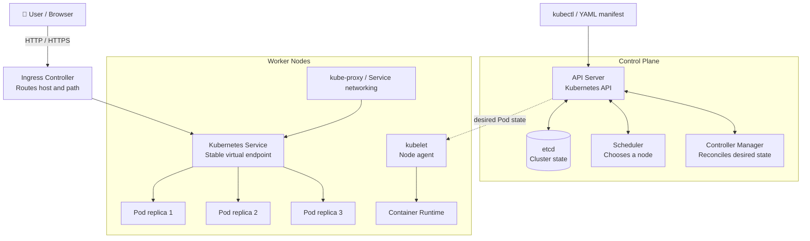

# ☸️ Kubernetes Cheatsheet

<p align="center">
  <strong>A practical, beginner-friendly Kubernetes learning lab</strong><br/>
  Learn Kubernetes concepts by exploring real YAML manifests, running local clusters, and deploying applications.
</p>

<p align="center">
  
  
  
</p>

---

## 👋 Welcome

This repository is a hands-on collection of Kubernetes examples. It is designed to help you move from the basics—Pods, Deployments, and Services—to application routing, service discovery, persistent storage, scheduled workloads, StatefulSets, and a small full-stack microservices deployment.

**New to Kubernetes?** Start with the learning path below, apply one manifest at a time, and read the detailed notes in **[docs/README.md](docs/README.md)**.

## 🧭 Learning path

| Step | Topic | What you will learn | Example |
|---|---|---|---|
| 1 | Cluster and namespace | Local cluster structure and workload isolation | `kind-config.yaml`, `namespace.yaml` |
| 2 | Pods | Smallest deployable Kubernetes unit | `pod.yaml`, `pod-nodeport.yml` |
| 3 | Deployments | Replica management and rolling updates | `deployment.yaml`, `deployment-nodeport.yaml` |
| 4 | Services | Stable networking for Pods | `service.yaml`, `service-nodeport.yaml` |
| 5 | Service discovery | DNS-based communication between workloads | `service-discovery/` |
| 6 | Ingress | HTTP routing to multiple Services | `ingress/` |
| 7 | Storage | PersistentVolumes and PersistentVolumeClaims | `persistent-volumn*.yaml` |
| 8 | Batch workloads | One-time and scheduled tasks | `job.yaml`, `cron-job.yaml` |
| 9 | Node-level workloads | Run a Pod on each eligible node | `daemonSets.yaml` |
| 10 | Stateful applications | Stable identity and persistent data for MySQL | `statefulset-configmap.yaml` |
| 11 | Full-stack project | Frontend, API, MongoDB, Kubernetes and Skaffold | `next15-micro-k8s/` |

## 🏗️ Kubernetes architecture

The diagram shows the common request path and the main cluster components. It is a learning-level view; exact networking and ingress implementation depends on the cluster and installed controllers.



### How to read the diagram

1. You describe the desired application state in a YAML manifest and submit it with `kubectl`.
2. The API Server validates and exposes the Kubernetes API. The cluster state is stored in etcd.
3. The scheduler selects a suitable worker node for each newly scheduled Pod.
4. Controllers continuously compare the actual cluster state with the desired state and take corrective action.
5. The kubelet on a worker node works with the container runtime to keep assigned Pods running.
6. A Service gives a changing set of Pods a stable network endpoint. An Ingress resource defines HTTP routing rules; an Ingress controller implements those rules.
7. Traffic reaches the Service and is routed to one of its ready Pod endpoints.

> **Important:** In modern Kubernetes, Docker Engine is not itself the Kubernetes container runtime interface implementation. Kubernetes nodes commonly use containerd or CRI-O. Docker can still be used to build images and to run KinD node containers.

## 📁 Repository map

```text
kubernetes-cheatsheet/
├── docs/
│   └── README.md                 # Detailed beginner notes and walkthrough
├── ingress/                      # Ingress, NGINX and Apache examples
├── service-discovery/            # Pod-to-Service DNS and networking tests
├── next15-micro-k8s/              # Next.js + Express + MongoDB demo
│   ├── k8s/                       # Namespace, MongoDB, API and frontend manifests
│   ├── next-app/
│   ├── contact-service/
│   ├── skaffold.yaml
│   └── README.md
├── kind-config.yaml               # Local KinD cluster definition
├── namespace.yaml                 # nginx-test namespace
├── pod.yaml                       # Basic Pod
├── deployment.yaml                # NGINX Deployment
├── service.yaml                   # ClusterIP Service
├── deployment-nodeport.yaml        # Fleetman Deployment example
├── service-nodeport.yaml           # NodePort Service example
├── job.yaml                       # One-time batch workload
├── cron-job.yaml                  # Scheduled batch workload
├── daemonSets.yaml                # DaemonSet example
├── persistent-volumn.yaml         # PersistentVolume example
├── persistent-volumn-claim.yaml  # PersistentVolumeClaim example
├── statefulset-configmap.yaml     # MySQL StatefulSet + ConfigMap + storage
└── dashboard-admin-user.yml       # Dashboard ServiceAccount/RBAC example
```

## 🚀 Quick start

### Prerequisites

Install the following tools:

- [kubectl](https://kubernetes.io/docs/tasks/tools/) — Kubernetes command-line client.
- [Docker](https://docs.docker.com/get-docker/) — container engine.
- [KinD](https://kind.sigs.k8s.io/) or [Minikube](https://minikube.sigs.k8s.io/) — local Kubernetes cluster.

Check the installations:

```bash
kubectl version --client
docker version
kind version
```

### 1. Create a local KinD cluster

The repository's `kind-config.yaml` describes one control-plane node and three worker nodes. It maps host ports 80 and 443 to the configured worker node.

```bash
kind create cluster --name learning-cluster --config kind-config.yaml
kubectl cluster-info
kubectl get nodes -o wide
```

> The config uses KinD node image `kindest/node:v1.33.1`. Check that the image is available and compatible with your installed KinD release.

### 2. Create the namespace

```bash
kubectl apply -f namespace.yaml
kubectl get namespaces
```

### 3. Deploy a simple Pod

```bash
kubectl apply -f pod.yaml
kubectl get pods -n nginx-test
kubectl describe pod nginx-pod -n nginx-test
kubectl logs nginx-pod -n nginx-test
```

### 4. Move to a Deployment and Service

Apply the resources in order:

```bash
kubectl apply -f deployment.yaml
kubectl apply -f service.yaml

kubectl get deployments -n nginx-test
kubectl get replicasets -n nginx-test
kubectl get pods -n nginx-test -o wide
kubectl get services -n nginx-test
```

### 5. Clean up

```bash
kubectl delete -f service.yaml
kubectl delete -f deployment.yaml
kubectl delete -f pod.yaml
kubectl delete -f namespace.yaml
kind delete cluster --name learning-cluster
```

## 📚 Detailed notes

The main README is an overview. The separate documentation file explains Kubernetes concepts, every major manifest group, YAML fields, commands, example flows, troubleshooting, and safety notes.

➡️ **[Open the detailed Kubernetes beginner notes](docs/README.md)**

## 🧪 Practical projects and examples

| Area | Directory / file | Practice goal |
|---|---|---|
| Ingress routing | [ingress/](ingress/) | Route `tws.local` paths to Apache and NGINX Services |
| Service discovery | [service-discovery/](service-discovery/) | Resolve Services with cluster DNS and connect between Pods |
| Stateful application | [statefulset-configmap.yaml](statefulset-configmap.yaml) | Explore MySQL, a headless Service, configuration and persistent storage |
| Next.js microservices | [next15-micro-k8s/](next15-micro-k8s/) | Deploy a frontend, contact API and MongoDB with Skaffold |

## ⚠️ Learning and security notes

These manifests are educational examples, not production deployment recipes. Before using them in a real environment:

- Pin container images to reviewed versions or digests instead of relying on `:latest`.
- Store credentials in Kubernetes Secrets or an external secrets manager; do not commit real passwords.
- Avoid granting `cluster-admin` to an application or Dashboard user. Apply least-privilege RBAC.
- Review `hostPath` volumes carefully. They expose node filesystem paths and are not portable shared storage.
- Define resource requests and limits under the Pod's container specification.
- Check that the Ingress controller and its matching IngressClass are installed before applying Ingress rules.
- Confirm storage classes exist in your cluster before applying PVC examples.

The detailed notes call out known caveats in the current examples so learners can understand what to validate before running them.

## 🧰 Useful kubectl commands

```bash
# Cluster and context
kubectl config get-contexts
kubectl config current-context
kubectl get nodes

# Workloads
kubectl get all -n nginx-test
kubectl get pods -o wide -n nginx-test
kubectl describe deployment nginx-deployment -n nginx-test
kubectl logs <pod-name> -n nginx-test

# YAML inspection and validation
kubectl explain deployment.spec
kubectl apply --dry-run=client -f deployment.yaml
kubectl diff -f deployment.yaml

# Troubleshooting
kubectl get events -n nginx-test --sort-by=.metadata.creationTimestamp
kubectl describe pod <pod-name> -n nginx-test
kubectl exec -it <pod-name> -n nginx-test -- sh
```

## 📖 Official learning resources

- [Kubernetes Concepts](https://kubernetes.io/docs/concepts/)
- [Kubernetes Tasks](https://kubernetes.io/docs/tasks/)
- [kubectl Cheat Sheet](https://kubernetes.io/docs/reference/kubectl/cheatsheet/)
- [KinD documentation](https://kind.sigs.k8s.io/)
- [Minikube documentation](https://minikube.sigs.k8s.io/docs/)

---

<p align="center">
  Made for learning Kubernetes one manifest at a time · <a href="https://github.com/amitweb2012">Amit Das</a>
</p>
